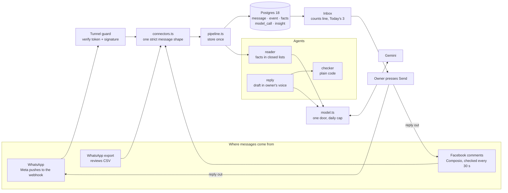
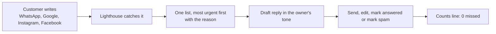

# OF4 Lighthouse

One inbox for a small business owner, where no customer message is missed.

Customers write on WhatsApp, leave Google reviews and comment on Instagram and Facebook. The owner checks each app when they remember. Lighthouse brings every message into one list, puts the most urgent on top with the reason in plain words, drafts a reply in the owner's tone, and proves with one line that nothing was missed:

```
14 arrived: 8 answered, 5 waiting, 1 spam, 0 missed
```

## What is new

| Idea | Usual tools | Lighthouse |
|---|---|---|
| Nothing missed, proven | An unread badge | A counts line. Arrived always equals answered plus waiting plus spam |
| Urgency from facts | Sort by time, or a mood score | Star rating, hours waiting, refund or delivery words, repeat customer. The reason is shown |
| Spam is counted, never lost | Hidden or deleted | Its own count, and the owner can bring it back |
| Counted once | The same message shows twice | Each message gets an id from its content |
| Two doors, one order | A digest or an inbox | Today's 3 is always the top three of the inbox |


## Tech stack

Next.js 16 and React 19 with server actions, Postgres 18 through Drizzle, Zod strict shapes, Gemini through one model door with a daily cap, Composio for Facebook, Meta's Cloud API for WhatsApp, secrets from 1Password at start. Full table, versions and file paths: [`docs/tech-stack.md`](docs/tech-stack.md).



## The owner's loop



## Run it

Needs Node 24, pnpm and a local Postgres that trusts your Linux user over its socket.

```
createdb lighthouse
pnpm install
pnpm db:setup
pnpm build && pnpm start
```

Open http://127.0.0.1:4174. It listens on this computer only. Stop it with Ctrl+C when you are done.

## Use it, start to finish

1. **Bring your messages in.** Press "Add files" and pick a WhatsApp chat export (.txt) or a reviews file (.csv with platform, name, date, text and optional stars). Or press "Try the sample bakery".
2. **Say which name is you.** For a WhatsApp chat, pick your own name and press "That's me". Your lines teach the reply tone and are never counted as customers. A customer you already answered in the chat starts as answered.
3. **Read the tally.** One notch per customer message: green answered, amber waiting, grey spam. The right side must say 0 missed. If it ever does not, the screen turns red and says how many are stored but not shown.
4. **Work Today's 3.** The three most urgent messages, each with the facts that put it there: stars, refund or damage words, hours waiting, a repeat customer.
5. **Answer.** Press "Reply" to open a draft written the way you write, edit it, and press "Send reply". Or press "Mark answered" or "Spam". Every action shows Undo for six seconds.
6. **Watch it stay true.** Press "Watch my profiles". New Instagram, Google and Facebook comments drop in one by one with a light sweep, and the tally grows while missed stays 0.
7. **Check the rest.** "Everything else" has Waiting, Answered and Spam tabs. Anything can go back to waiting.
8. **Start over.** The link at the bottom clears the books for the next demo.

Loading the same file twice adds nothing. Each message is stored once by its content.


## Status

A prototype, stopped on 30 October 2026 after Dhruv agreed the OF4 direction. Facebook is live through Composio and WhatsApp through Meta's webhook on a test number; file imports still work. WhatsApp end to end from a real phone was never tested. The story is in [`docs/prototype-journey.md`](docs/prototype-journey.md).

Part of Swayu outcome family OF4, customer insights and brand monitoring. Owner: Sujit.
