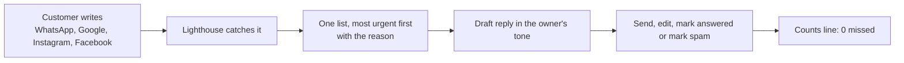

# OF4 Lighthouse

One inbox for a small business owner, where no customer message is missed.

Customers write on WhatsApp, leave Google reviews and comment on Instagram and Facebook. The owner checks each app when they remember. Lighthouse brings every message into one list, puts the most urgent on top with the reason in plain words, drafts a reply in the owner's tone, and proves with one line that nothing was missed:

```
14 arrived: 8 answered, 5 waiting, 1 spam, 0 missed
```

## What is new

| Idea | Usual tools | Lighthouse |
|---|---|---|
| Nothing missed, proven | An unread badge | A counts line. Arrived always equals answered plus waiting plus spam |
| Urgency from facts | Sort by time, or a mood score | Star rating, hours waiting, refund or delivery words, repeat customer. The reason is shown |
| Spam is counted, never lost | Hidden or deleted | Its own count, and the owner can bring it back |
| Counted once | The same message shows twice | Each message gets an id from its content |
| Two doors, one order | A digest or an inbox | Today's 3 is always the top three of the inbox |

## The owner's loop



## Status

A working prototype. Sources today are file imports (WhatsApp chat exports and a reviews CSV) and a simulated watcher. Sending a reply records it and sends nothing. Real connections come later.

Part of Swayu outcome family OF4, customer insights and brand monitoring. Owner: Sujit.
