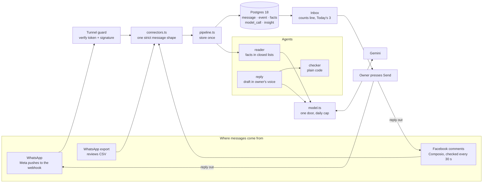
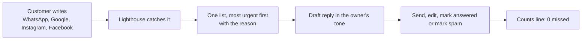
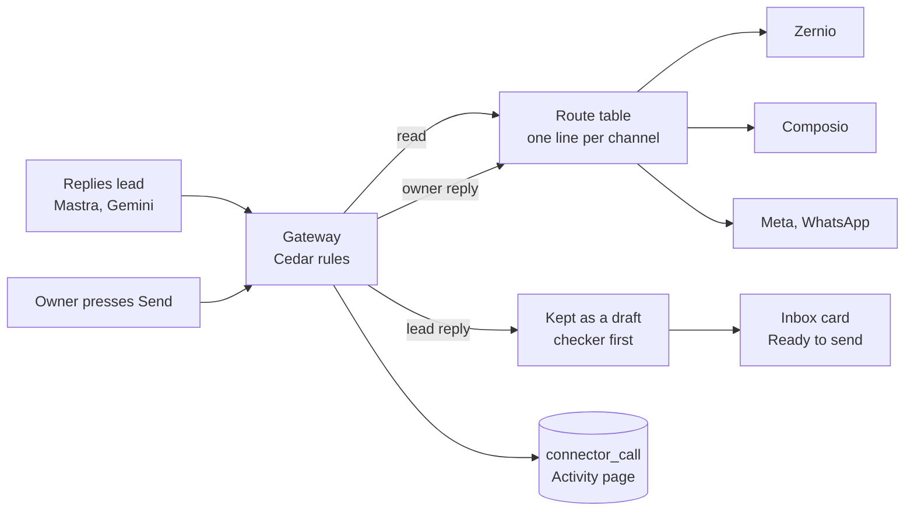

# OF4 Lighthouse

One inbox for a small business owner, where no customer message is missed.

Customers write on WhatsApp, leave Google reviews and comment on Instagram and Facebook. The owner checks each app when they remember. Lighthouse brings every message into one list, puts the most urgent on top with the reason in plain words, drafts a reply in the owner's tone, and proves with one line that nothing was missed:

```
14 arrived: 8 answered, 5 waiting, 1 spam, 0 missed
```

## What is new

| Idea | Usual tools | Lighthouse |
|---|---|---|
| Nothing missed, proven | An unread badge | A counts line. Arrived always equals answered plus waiting plus spam |
| Urgency from facts | Sort by time, or a mood score | Star rating, hours waiting, refund or delivery words, repeat customer. The reason is shown |
| Spam is counted, never lost | Hidden or deleted | Its own count, and the owner can bring it back |
| Counted once | The same message shows twice | Each message gets an id from its content |
| Two doors, one order | A digest or an inbox | Today's 3 is always the top three of the inbox |


## Tech stack

Next.js 16 and React 19 with server actions, Postgres 18 through Drizzle, Zod strict shapes, Gemini through one model door with a daily cap, Composio and Zernio behind one connector gateway with Cedar rules, Mastra for the lead agent, Meta's Cloud API for WhatsApp, secrets from 1Password at start. Full table, versions and file paths: [`docs/tech-stack.md`](docs/tech-stack.md).



## The owner's loop



## Run it

Needs Node 24, pnpm and a local Postgres that trusts your Linux user over its socket.

```
createdb lighthouse
pnpm install
pnpm db:setup
pnpm build && pnpm start
```

Open http://127.0.0.1:4174. It listens on this computer only. Stop it with Ctrl+C when you are done.

## Use it, start to finish

1. **Bring your messages in.** Press "Add files" and pick a WhatsApp chat export (.txt) or a reviews file (.csv with platform, name, date, text and optional stars). Or press "Try the sample bakery".
2. **Say which name is you.** For a WhatsApp chat, pick your own name and press "That's me". Your lines teach the reply tone and are never counted as customers. A customer you already answered in the chat starts as answered.
3. **Read the tally.** One notch per customer message: green answered, amber waiting, grey spam. The right side must say 0 missed. If it ever does not, the screen turns red and says how many are stored but not shown.
4. **Work Today's 3.** The three most urgent messages, each with the facts that put it there: stars, refund or damage words, hours waiting, a repeat customer.
5. **Answer.** Press "Reply" to open a draft written the way you write, edit it, and press "Send reply". Or press "Mark answered" or "Spam". Every action shows Undo for six seconds.
6. **Watch it stay true.** Press "Watch my profiles". New Instagram, Google and Facebook comments drop in one by one with a light sweep, and the tally grows while missed stays 0.
7. **Check the rest.** "Everything else" has Waiting, Answered and Spam tabs. Anything can go back to waiting.
8. **Start over.** The link at the bottom clears the books for the next demo.

Loading the same file twice adds nothing. Each message is stored once by its content.

## The connector gateway, since 4 November 2026

Every read and reply on a customer channel goes through one door, `src/gateway/`. Order on every call: the Cedar permission check, the owner's approval when the rule asks for it, one provider picked by the route table, a ledger row at each step.



| Part | File | What it does |
|---|---|---|
| Rules | `policies/connectors.cedar`, `.cedarschema` | Which lead may read or reply on which channel. A reply needs the owner. A misspelled name stops startup |
| Door | `src/gateway/gateway.ts` | Checks, asks, routes, writes the ledger. A lead's reply is held, never sent |
| Routes | `src/gateway/setup.ts` | Facebook read Zernio, reply Composio; Instagram and Google reviews Zernio; WhatsApp Meta |
| Lead | `src/gateway/leads.ts`, `src/drafting.ts` | After each check, the replies lead drafts one reply per new waiting message, holding reply tools only |
| Screens | `/inbox`, `/activity` | A ready reply sits on its card with Send; Activity shows every call in plain words |

## Walk it through, about five minutes

1. `pnpm build && pnpm start:op`, then open http://127.0.0.1:4174/inbox. Keep the tab open: it checks every channel every 30 seconds.
2. The top shows each channel and when it was last checked. Facebook and Instagram are live test accounts read through Zernio.
3. Today's 3 shows the most urgent messages, each with the reason and a reply marked Ready to send. The replies lead wrote it, the checker passed it, and nothing has been sent.
4. Press Edit to change a reply, or Send to post it. Send is the owner's approval: the gateway records it, then posts through Composio on Facebook or Zernio on Instagram.
5. Open Activity. Each read, each draft kept, each reply posted, and each call the rules stopped, in one sentence.
6. To see the rules hold: `pnpm exec vitest run tests/leads.test.ts tests/setup.test.ts tests/gateway.test.ts`. The ads lead is handed no reply tool at all; a reply forced through the gateway is refused and recorded; the owner's door does not widen the rules. These tests need no model, so a busy Gemini cannot stop them.

When Gemini is busy (it answered 503 several times on 4 November), new messages still arrive and count, and Reply opens the plain draft instead of a ready one. The drafting retries a minute later.

## Status

A prototype. Stopped on 30 October 2026 after Dhruv agreed the OF4 direction, then picked up on 4 November 2026 as the connector layer comparison Dhruv asked for: Composio and Zernio both behind one gateway, permissions at the connector level, the lead loop on Mastra, tested on real test accounts. Facebook and Instagram are live through the gateway, WhatsApp through Meta's webhook on a test number; file imports still work. Not yet proven: a reply through Zernio on any channel, Google reviews with a real profile, WhatsApp from a real phone. The story is in [`docs/prototype-journey.md`](docs/prototype-journey.md).

Part of Swayu outcome family OF4, customer insights and brand monitoring. Owner: Sujit.
