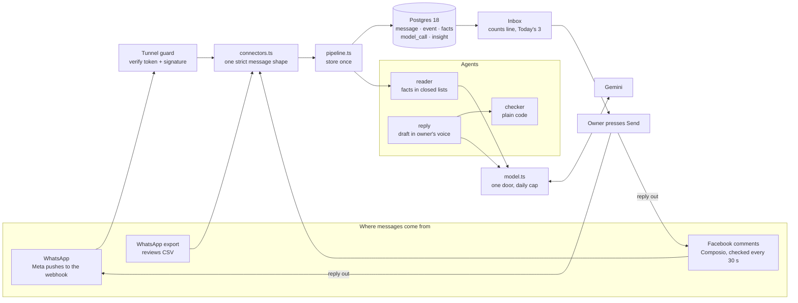
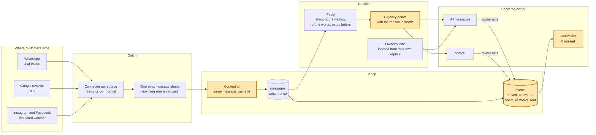
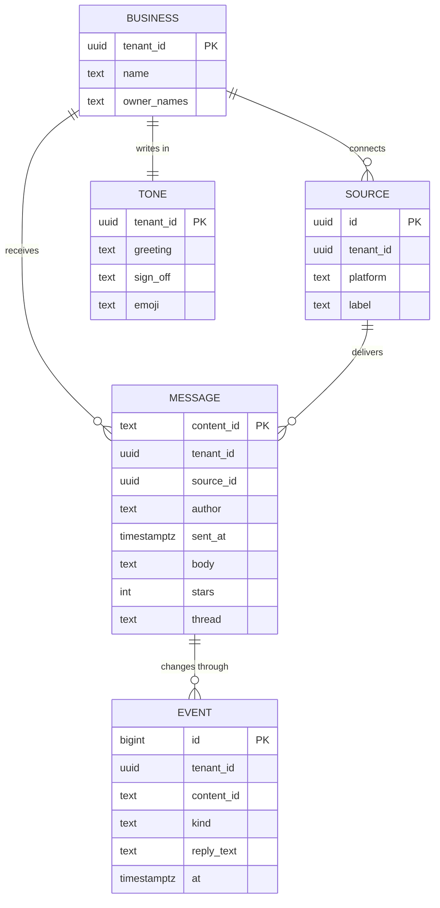
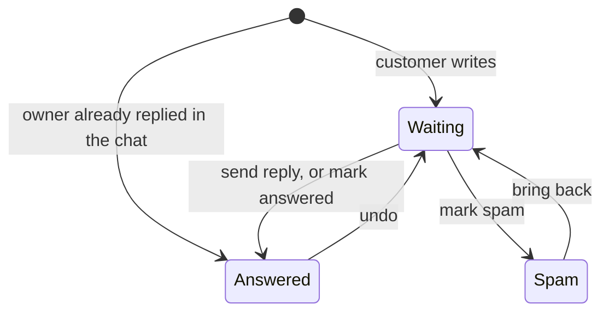
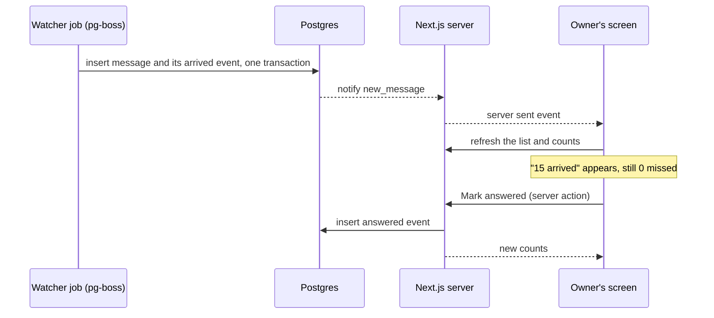

# OF4 Lighthouse: architecture

Version 1. Owner: Sujit. Date: 29 October 2026. Status: draft for Dhruv's review.

The PRD (`docs/prd.md`) says what the owner gets. This page says how it is built, and why.

## The tech stack as built

Read this first. The sections below are the plan of 29 October; this is what runs after the build of 30 October. Versions, file paths and the full diagram: [`tech-stack.md`](tech-stack.md).



| Layer | Built with |
|---|---|
| Screens and buttons | Next.js 16, React 19, server actions |
| Data | Postgres 18 through Drizzle |
| Input checking | Zod, strict shapes |
| Model | Gemini through one model door with a daily cap |
| Facebook | Composio, checked every 30 seconds while the inbox is open |
| WhatsApp | Meta Cloud API webhook in, Graph API out |
| Secrets | 1Password at start, never in a file |

## 1. The one idea the design protects

Most inbox tools count by looking. They show a list and trust that the list is complete. Lighthouse counts by bookkeeping. Every message that arrives is written once, every change to it is written as an event, and the counts line is a sum the database computes. If the sum ever fails to add up, the screen turns red.

So the claim "0 missed" is not a feeling. It is arithmetic the owner can check:

```
arrived = answered + waiting + spam,  missed = arrived - (answered + waiting + spam) = 0
```

Every choice below serves that one line.

## 2. The stack

This section is the plan of 29 October. What was actually built is in [`tech-stack.md`](tech-stack.md).

The stack is the one `Swayuhq/swayu-app` already runs, at the same pinned versions. If Lighthouse wins, it moves into the product with no rewrite.

| Layer | Choice | Version | Why this one |
|---|---|---|---|
| Language | TypeScript | 6.0.3 | One language from the file parser to the screen |
| App and screens | Next.js App Router, React | 16.4.1, 19.3.0 | Server actions handle the owner's buttons with no separate API to keep in step |
| Look | Tailwind | 4.3.3 | Design tokens in one file, so Lighthouse keeps its own identity cleanly |
| Database | Postgres | 18 (installed locally) | The counts line is a query; uniqueness and the event log are database rules, not app code |
| Database access | Drizzle and drizzle-kit, `postgres` client | 0.45.4, 0.31.11, 3.4.9 | Typed queries and migrations, same as the product |
| Background jobs | pg-boss | 12.38.0 | A job queue that lives inside Postgres. Watchers and the daily Today's 3 run as jobs with no Redis to run |
| Checking input | Zod, strict | 4.6.5 | Every message from every source passes one strict shape before it is stored |
| Tests | Vitest | 5.0.3 | Same runner as the product |

Versions are read from `swayu-app/package.json` and the npm registry on 29 October 2026.

### Why not the alternatives

| Option | What it costs | Why it lost |
|---|---|---|
| Keep today's single static page | Nothing more | No saved state, no live watcher, no path into the product. Good for the film, not for a team trial |
| Next.js, Postgres and pg-boss (chosen) | One local database, already running | Grows into the product as is. One process to run |
| Vite page, a separate API server, Redis and BullMQ | Three things to run and keep in step | More moving parts and a different stack from swayu-app, so a rewrite when it joins the product |

## 3. How a message flows

Highlighted boxes are where Lighthouse does something other tools do not.



Four steps, each with one job:

1. **Catch.** Each source has a connector that reads its own format and returns messages in one shared shape. A connector knows nothing about urgency or counts. Adding YouTube later means writing one connector.
2. **Keep.** Each message gets an id made from its content. The database refuses a second copy, so loading the same file twice changes nothing. Every owner action is a new event row; nothing is edited in place.
3. **Decide.** Urgency comes from facts only (Harish, 14 October): stars, hours waiting, refund words, a repeat customer. Each point carries the plain reason the owner sees.
4. **Show.** Today's 3 and the full list read the same ordered query, so the push and the pull can never disagree.

## 4. What is stored



Three rules hold in the database itself, not in app code:

| Rule | How the database holds it |
|---|---|
| Counted once | `content_id` is the primary key within a business; inserts use `on conflict do nothing` |
| A message is always in exactly one state | Its state is its newest event. A message with no event is impossible, because the insert and its `arrived` event commit together |
| Every row knows whose it is | `tenant_id` on every table from day one, as swayu-app rule 10 asks |

The counts line is one query over the newest event per message. It never reads a cached number.

## 5. The life of one message



Every arrow is one event row. Undo is a new event, not a delete, so the history stays whole and the counts stay honest.

## 6. Live updates



The watcher is a job on a timer. In the prototype it drops sample Instagram, Google and Facebook comments. A real connector later replaces only the job's body; the rest of the flow does not change.

## 7. Where the code lives

```
app/                  screens and server actions (Next.js)
  page.tsx            the inbox: counts line, Today's 3, the list
  connect/page.tsx    add a file, "Which name is you?"
  api/live/route.ts   server sent events for new messages
src/
  connectors/         whatsapp.ts, reviews-csv.ts, simulated.ts
  message.ts          the one strict message shape (Zod)
  urgency.ts          the points table and the reasons, pure functions
  tone.ts             learn the tone, draft the reply, pure functions
  store/              Drizzle schema, migrations, the counts query
  jobs/               watcher and daily Today's 3 (pg-boss)
tests/                one test file per src file, plus the counts invariant
```

The pure functions (`urgency.ts`, `tone.ts`, the connectors) carry over from today's prototype as they are. The 26 tests that pass today move with them.

## 8. What can go wrong, and the guard

| Case | Guard |
|---|---|
| The same export is loaded twice | Content id primary key; nothing new is stored |
| A file is not a WhatsApp export or a CSV | The connector returns one plain sentence; nothing is stored |
| A source sends a field we do not know | The strict shape refuses it; nothing is stored |
| The owner presses Mark answered twice | The second event matches the current state and is skipped |
| The watcher crashes halfway | Message and event commit together or not at all; pg-boss retries the job |
| Two tabs are open | Both read the same database and both get the live update |
| A very old export | Hours waiting is measured from the newest loaded message, not the clock (PRD section 6) |

## 9. Not in this version

| Left out | Why |
|---|---|
| Real sending and the real daily push | Sending belongs to the delivery path in swayu-app (rule 1). The prototype records the reply |
| Live platform connections | They need accounts, keys and the Google and YouTube policy answers |
| Model written replies | Version 1 drafts from fixed sentences and never invents a fact. A model would sit behind one function, `draftReply`, through the shared model client |
| Login | One business on one laptop |
| Sentiment in the order | Harish's ruling of 14 October |

## 10. What the first build changed (29 October)

| Planned | Built | Why |
|---|---|---|
| pg-boss runs the watcher | The screen asks the server for the next comment every few seconds while "Watch my profiles" is on | pg-boss is a new package and needs an audit first. Swapping it in later touches one server action |
| Postgres notify pushes new messages to the screen | The page reloads its data after every action and every watcher tick | One owner, one screen. Push updates matter once two people share an inbox |
| drizzle-kit migrations | `src/store/schema.sql`, run with `pnpm db:setup`; Drizzle still runs every query | drizzle-kit cannot reach Postgres over the local socket, and the socket needs no password |
| A separate connect page | One page; the welcome state and "Which name is you?" sit on it | Fewer screens for the owner |
| The counts line is one SQL query | The database count of customer messages is compared with what the screen shows; the gap is "missed" | Same proof, simpler to read |

The run steps are in the README.
