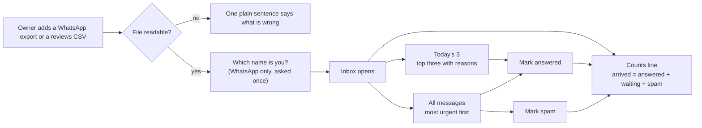
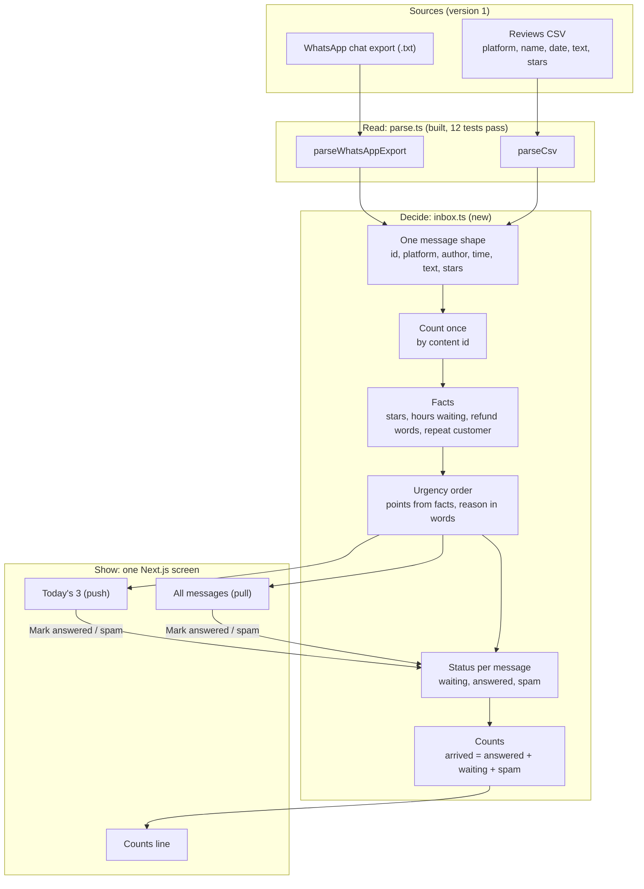
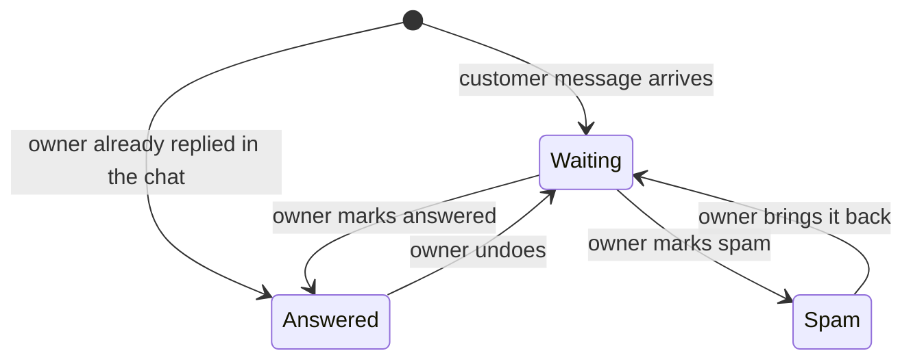

# OF4 Lighthouse: one inbox, nothing missed

Version 1 PRD. Owner: Sujit. Date: 29 October 2026. Status: draft for Dhruv's review. Updated 29 October: built on Swayu's own stack (Next.js, Postgres, Drizzle, Zod) with model agents, by Sujit's decision. The stack and the stores are in `architecture.md`.

## 1. The problem, in the owner's words

"My customers write to me on WhatsApp, leave Google reviews and comment on Instagram. I check each app when I remember. Some messages wait two days. Some I never see. I only find out when the one star review is already public."

Three facts make this costly for a small business owner:

1. Messages are spread across apps, so the owner has no single list.
2. Every app sorts by time, not by what needs the owner first.
3. No app tells the owner what was missed. A missed message is invisible until it hurts.

## 2. What we build

The whole OF4 loop, as a working picture:

1. Customers write on WhatsApp, Google reviews, Instagram and Facebook.
2. Swayu watches the owner's profiles and catches each new message. In the prototype the watcher drops sample comments in live; real connections come later.
3. Swayu pulls everything into one list on the owner's Swayu page. The most urgent message is on top, and the reason is written in plain words.
4. Swayu drafts a reply in the owner's own tone, learned from the owner's past replies.
5. The owner sends it as it is, edits it, marks it answered, or marks it spam.
6. A counts line proves nothing was missed.

The owner reaches the same list through two doors:

| Door | What the owner gets | When |
|---|---|---|
| **Push: Today's 3** | The three most urgent messages, each with its reason, plus "and N more waiting" | Once a day, sent by Swayu. The prototype shows it on screen and sends nothing |
| **Pull: the inbox** | Every message, most urgent first | Whenever the owner opens it |

Push and pull are not two products. They are one urgency order with two doors. Harish chooses the push time and channel on today's call.

## 3. What is new here

| Idea | What other tools do | What we do |
|---|---|---|
| **Nothing missed, proven** | Show a list and an unread badge | A counts line: `12 arrived: 7 answered, 4 waiting, 1 spam, 0 missed`. Arrived must equal answered plus waiting plus spam. This is the approved O163 check |
| **Urgency from facts, with the reason shown** | Sort by time, or by a mood score nobody can check | Order by facts the owner can verify: star rating, hours waiting, refund or delivery words, repeat customer. Each message shows why it is high: "1 star, waiting 26 hours, says refund" |
| **Spam is counted, never lost** | Hide or delete it | Spam moves to its own count. The owner can bring it back. Arrived still adds up |
| **Counted once** | The same message from two exports shows twice | Each message gets an id from its content. Loading the same file twice changes nothing |
| **Two doors, one order** | A digest tool or an inbox tool | Today's 3 is always the top three of the inbox, so the push and the pull never disagree |

What we borrowed and what we refused, from the competitor study of 29 October (Drive, OF4 work by date, 2026-10-29):

| From | Borrowed | Refused, and why |
|---|---|---|
| Clay lead flow | Trigger on each new message, enrich with facts, score, split out spam | Assigning a rep, because most owners work alone. A flowchart builder, because repo rule 4 forbids a canvas for the owner |
| Jasper | One shared owner profile that every outcome reads (version 2) | Seat pricing and team features, because our owner is one person |

## 4. The owner's journey

The owner's own WhatsApp lines are never counted as customer messages. A customer message the owner replied to later in the same chat starts as answered. That is why we ask "Which name is you?" once.

## 5. How the system works

Every message is in exactly one state. That is what makes the counts line add up.

## 6. The urgency order

Points come only from facts. Mood and sentiment are never used, by Harish's ruling of 14 October.

| Fact | Points | Reason shown to the owner |
|---|---|---|
| 1 or 2 stars | 3 | "1 star" |
| Refund, money back, not delivered, damaged, wrong item, cancel | 3 | "says refund" |
| Waiting more than 24 hours | 2 | "waiting 26 hours" |
| Waiting 4 to 24 hours | 1 | "waiting 6 hours" |
| Same customer wrote before | 1 | "wrote before" |

Higher points come first. Equal points: the one waiting longer comes first. Answered and spam messages leave the order.

"Now" is the time of the newest message across the loaded files, not the clock. An export from last month would otherwise show every message as waiting 700 hours. The live product uses the clock.

The point values are a first guess. They are visible in one table in the code so Dhruv and Harish can change them in one place.

## 7. Done, as checks we can run

| Done means | Proof |
|---|---|
| A WhatsApp export and a CSV load into one list | Unit test with both sample files |
| The same file loaded twice adds nothing | Unit test: counts identical after the second load |
| Arrived equals answered plus waiting plus spam, and missed is 0 | Unit test after every action; the counts line turns red if it ever fails |
| The owner's own lines are not counted, and replied messages start as answered | Unit test with a two person chat |
| Each message shows its reason in words | Unit test on the reason text |
| Today's 3 is always the top three of the inbox | Unit test |
| No mood word affects the order | Unit test: "angry" and "terrible" with no other fact score 0 |
| An unreadable file shows one plain sentence and changes nothing | Unit test, already in the parser |
| The whole flow works in a browser | Screen recording of the demo, start to finish |

## 8. Not in version 1

| Left out | Why | When |
|---|---|---|
| An open ended agent loop | Each agent is one model call with a strict answer shape. Cheaper, predictable, and easy to show why it chose what it chose | Not planned |
| Live Google reviews, Instagram or WhatsApp API | Needs accounts, keys and policy answers (GBP storage rules, YouTube project) | After the data flow is agreed with Hatim |
| Sending replies or the push for real | Sending touches the sanctioned delivery path in swayu-app (rule 1). The prototype records the reply and shows it as ready | When the prototype joins the product |
| A dashboard screen | A second screen breaks the first product rule. The counts line does its job | Never as a separate screen |
| Saving to a server, login | A prototype for one owner on one laptop | When it joins the product |
| Sentiment | Harish's 14 October ruling. HRB's sentiment app is separate | Only as an insight, if Dhruv allows |

## 9. Build plan

Plain code keeps the arithmetic: counting, the duplicate check, the urgency points and "0 missed". A model is used only where the meaning of words matters, and every model step falls back to the plain rules if it fails. All model calls go through one client with a daily spending cap, a timeout that cancels the request, and a strict answer shape.

| Step | Output | Status |
|---|---|---|
| 1 | Parser, inbox logic, counts, Postgres books, one screen, simulated watcher | Done, 29 Oct |
| 2 | One model client with the cap, timeout and shape check | Done, 29 Oct |
| 3 | Reader agent: each message becomes facts (kind, problem, what they ask, deadline). Closed lists, never mood. Catches "I want my money", Hinglish and polite spam | Built, 29 Oct; live run needs a key |
| 4 | Reply agent: a draft from the owner's past replies and the customer's actual question, run only when the owner presses Reply | Built, 29 Oct; live run needs a key |
| 5 | Checker, plain code: refuses a draft that states a number, day or promise nobody gave | Built, 29 Oct |
| 6 | Insights agent: up to 5 themes shared by two or more messages, counted in code, shown as "What customers keep saying" | Built, 29 Oct; live run needs a key |
| 7 | Demo recording and README | Last |

Repository: `Swayuhq/of4-lighthouse`, private, the same pattern as `Swayuhq/of3-prototype`.

## 10. Open questions

| For | Question |
|---|---|
| Harish | Push time and channel for Today's 3: morning WhatsApp, or email? |
| Dhruv | Are the urgency facts and point values right for version 1? |
| Dhruv | May sentiment appear as an insight only, never in the order? |
| Hatim | Which shared data layer will the live sources write into? |
| HRB | One shared owner profile: what fields does it hold first? |
