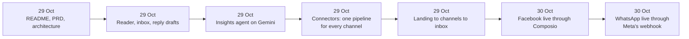
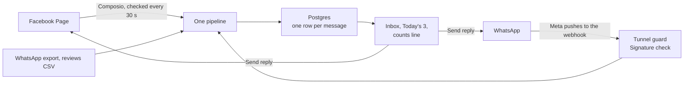

# OF4 Lighthouse: the prototype journey

29 to 30 October 2026. Built by Sujit for OF4, customer insights and brand monitoring.

## Why it exists

Dhruv asked for a clear win for the OF4 outcome family: one working prototype on one or two platforms, in its own repository, due Wednesday 28 October. Lighthouse is that win. Dhruv saw it and agreed with the direction. The prototype now stops here. It is a reference for the real build, not a product we keep iterating on.

## The idea in one line

A small business owner never misses a customer message, and can prove it.

```
14 arrived: 8 answered, 5 waiting, 1 spam, 0 missed
```

| Owner's problem | What Lighthouse does |
|---|---|
| Messages are spread over WhatsApp, Instagram, Facebook and Google | One list, every channel |
| No idea which message matters most | Today's 3: the three most urgent, with the reason in plain words |
| Replying takes time | A draft in the owner's own tone, edited and sent from the list |
| An unread badge proves nothing | The counts line. Arrived always equals answered plus waiting plus spam |
| Spam hides real customers | Spam is counted, never deleted, and can be brought back |

## The ideology

1. **Facts, not mood scores.** Urgency comes from stars, hours waiting, refund or delivery words and repeat customers. The reason is always shown.
2. **Proof over promise.** "0 missed" is a database query, not a label. If it ever fails, the screen turns red.
3. **Counted once.** Each message gets an id from its content, so loading the same data twice adds nothing.
4. **Simple for the owner.** Few buttons: Reply, Mark answered, Spam, Undo. No agents, no jargon on screen.
5. **Never invent.** Drafts come from the owner's own lines and the message. Nothing is claimed that the message did not say.

## How it was built, step by step



| Date | Commit | What changed for the owner |
|---|---|---|
| 29 Oct | 7e79db3 | The README: what Lighthouse is and how to run it |
| 29 Oct | 2c95860 | Load a WhatsApp chat export or a reviews file and see one ranked list with draft replies |
| 29 Oct | 004a212 | "What customers keep saying": themes tied to the real messages |
| 29 Oct | 85a6ee5 | The agents run on Gemini; themes clear when the owner starts over |
| 29 Oct | 5db67d7 | WhatsApp, Instagram, Facebook and Google reviews all feed one pipeline |
| 29 Oct | 8dcdcbf | The owner walks from the landing page to connecting channels to the inbox |
| 30 Oct | 4ab4ab8 | Facebook is live: real comments arrive and a reply posts back to the Page |
| 30 Oct | 802665c | WhatsApp is wired to receive and answer live through Meta's webhook |

## What it is built with

Full stack and architecture diagram: [`tech-stack.md`](tech-stack.md).

| Part | Choice | Why |
|---|---|---|
| Screens and buttons | Next.js 16 and React 19, server actions | No separate API to keep in step |
| Data | Postgres 18 | The counts line and "counted once" are database rules |
| Checking channels | The open inbox checks connected channels every 30 seconds | Fastest to prove; webhooks or a server job replace it |
| Agents | Gemini, key read from 1Password at start | Insights and themes |
| Facebook | Composio | Fastest path to a real read and reply on a test Page |
| WhatsApp | Meta Cloud API webhook | Meta pushes each message to us |
| Secrets | 1Password references in `.env.op` | No value ever sits in a file |

## The channel design



WhatsApp safety, three locks:
1. **Verify handshake.** Meta's setup call is answered only with the right verify token. A wrong token gets 403.
2. **Signature check.** Every message must carry Meta's signature made with our app secret. Unsigned gets 401.
3. **Tunnel guard.** Through the public tunnel only the webhook is reachable. The inbox through the tunnel gets 404.

## Proof

| Check | Result |
|---|---|
| Tests | 103 of 103 pass, typecheck clean |
| Tunnel guard mutation test | Goes red when the guard is removed |
| WhatsApp webhook on the running server | Handshake echoes the challenge; wrong token 403; unsigned 401; inbox through tunnel 404 |
| Facebook live | 2 real comments caught; reply "Thank you so much! Lighthouse test reply." read back from Facebook at 10:33:29 UTC |
| Meta test number | +1 555-143-6423, quality GREEN |
| Not proven | WhatsApp end to end with a real message from a phone. The prototype stopped before that test |

Screenshots: Research drive, Evidence, folder "2026-10-30 Sujit OF4 connectors".

## Designs and records kept as evidence

| Artifact | What it holds |
|---|---|
| [Swayu One Inbox](https://claude.ai/artifact/1deqpCABnmCiz98pJQtzg9) | The first design of the one inbox, before any code |
| [Lighthouse Real Channels](https://claude.ai/artifact/Rf8ANyaRsrJGpTDjfMRV1M) | How each real channel connects; source in `docs/artifacts/connect-real-channels.html` |
| [Lighthouse Connector Build Log](https://claude.ai/artifact/P8fwK58NyA9yZpNsLJNVEj) | Connector build versus buy, benchmarks; source in `docs/artifacts/connectors-build-vs-buy.html` |
| [OF4 Design Record](https://claude.ai/artifact/RQeawJQe1ic16NfAVsWzWK) | Every OF4 decision, finding and file, newest first |

## Limits we found

| Limit | Number | What it means |
|---|---|---|
| Meta Pages calls | 4,800 times engaged users per 24 hours | A new Page with 0 followers is near the minimum |
| Composio Hobby | 100,000 calls a month | Our 30 second check uses about 14,400 calls a day per open inbox |
| Composio Pro | $29 plus $0.0003 a call | About 700 dollars per owner per month at a 30 second check |
| WhatsApp service replies | 1,000 free per number a month since 1 Oct 2026, then paid | Cost grows with replies |
| WhatsApp test token | Expires 24 hours after it is made | A real demo needs a permanent system user token |
| Meta Tech Provider onboarding | 200 new customers per 7 days | 1,000 owners take at least five weeks after approval |

## What the research says for the real build

From the research of 30 October, in `~/swayu-handover/research/`:

1. **Meta approvals set the calendar, not the code.** Business Verification, App Review and Tech Provider must start early under Swayu's company portfolio.
2. **Push, not polling.** Webhooks plus a nightly catch up keep "0 missed" honest and cut cost. The 30 second check does not survive scale.
3. **Replying is posting in the owner's name.** It touches rule 1 and needs Harish's word before it ships in swayu-app.
4. **Auto send only safe replies.** Never anything with money, dates, complaints or low stars.
5. **Customer messages need their own retention policy** under rule 9.
6. **OF4 must write down its needs from the shared connector layer now**, so it does not build a parallel inbox that clashes with the stream later.

## Open, for whoever picks this up

| Item | Owner |
|---|---|
| Meta Business Verification, App Review, Tech Provider | Question for Harish |
| Who builds the shared connectors and reply path, and when | Question for Dhruv |
| WhatsApp end to end with a real phone | Not done; prototype stopped |
| Instagram, Facebook webhooks, one click Connect with Meta | Not started; prototype stopped |
