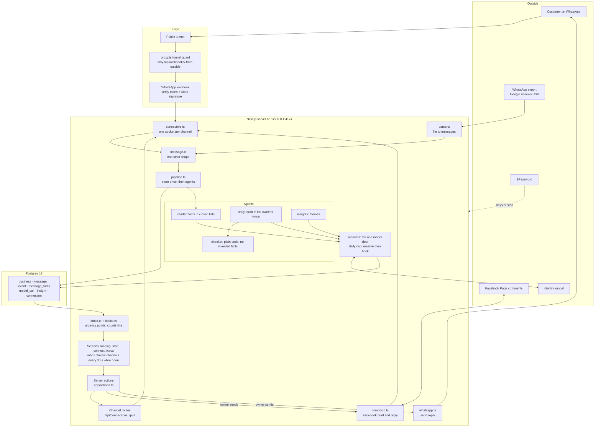

# OF4 Lighthouse: the tech stack as built

Read from the code on 31 October 2026, at commit `38e4b23`. This is what runs, not what was planned. Where the plan in `architecture.md` differs, the last section says how.

## The stack

| Layer | What it uses | Version | Where in the code |
|---|---|---|---|
| Language | TypeScript | 6.0.3 | everywhere |
| Screens and buttons | Next.js App Router, React, server actions | 16.4.1, 19.3.0 | `app/`, `app/actions.ts` |
| Look | Tailwind | 4.3.3 | `app/globals.css` |
| Input checking | Zod, strict shapes | 4.6.5 | `src/message.ts`, `src/facts.ts` |
| Database | Postgres, local | 18 | `src/store/schema.sql` |
| Database access | Drizzle with the `postgres` client | 0.45.4, 3.4.9 | `src/store/db.ts`, `src/store/schema.ts` |
| Model | Gemini `gemini-3.1-flash-lite`, through Google's OpenAI compatible endpoint | | `src/agents/model.ts` |
| Facebook | Composio, called over its MCP endpoint | | `src/composio.ts` |
| WhatsApp | Meta Cloud API: webhook in, Graph API v26.0 out | | `app/api/webhooks/whatsapp/route.ts`, `src/whatsapp.ts` |
| Secrets | 1Password references in `.env.op`, read once at start | | `scripts/start-op.sh` |
| Tests | Vitest | 5.0.3 | `tests/` |
| Package manager | pnpm | 10.33.0 | `package.json` |

The app listens on `127.0.0.1:4174` only. A public tunnel reaches the WhatsApp webhook and nothing else.

## The architecture

## The life of one message

1. A message arrives: Meta pushes a WhatsApp message to the webhook, the open inbox asks Composio for new Facebook comments every 30 seconds, or the owner adds a file.
2. `connectors.ts` turns each channel's shape into the one shape in `message.ts`. Anything that does not fit is refused before it is stored.
3. `pipeline.ts` stores it once. The id comes from the content, so the same message never counts twice.
4. The reader agent labels it with facts from closed lists (`facts.ts`). Labels only; it never counts.
5. `inbox.ts` gives urgency points from facts the owner can check, never from mood, and the counts line is plain code over the `event` table.
6. When the owner presses Reply, the reply agent drafts in the owner's voice and the checker refuses any draft that invents a number, a date or a promise.
7. The owner sends. The reply goes out through Composio or the WhatsApp Graph API, and an event row records it.

## Three safety locks on WhatsApp

1. Verify handshake: wrong verify token gets 403.
2. Meta signature with the app secret on every message: unsigned gets 401.
3. Tunnel guard: from outside, everything except `/api/webhooks/` gets 404, so the inbox and its send button stay private.

## How it lines up with swayu-app

| Lighthouse | swayu-app | Same idea |
|---|---|---|
| `model.ts`, one door with a daily cap | The shared model client, rule 6 | One path to the model, reserve before the call |
| `facts.ts`, closed lists | Rule 8 schema constrained extraction | Customer text never reaches an agent as free text it could act on |
| `event` table and the counts line | The ledger, rule 2 | Written when it happens, never rebuilt later |
| `checker.ts` | The checks layer | Nothing reaches the owner unchecked |
| `connectors.ts` | Connectors and channels layer | One socket, many platforms |

## Where the build differs from the plan in `architecture.md`

| Planned | Built | Why |
|---|---|---|
| pg-boss job queue for watchers | The open inbox page checks connected channels every 30 seconds | Faster to prove; a server job or webhooks replace it for real use |
| Server sent events at `app/api/live` | The same 30 second check, with a toast for new messages | One mechanism instead of two |
| `src/connectors/` folder, `urgency.ts`, `tone.ts` | `src/connectors.ts`, `src/inbox.ts`, `src/agents/reply.ts` | Fewer files while the shape settled |
| drizzle-kit migrations | One `schema.sql` run with `pnpm db:setup` | No migrations needed for a local prototype |

## What changes for a real build

* Webhooks for every channel instead of the 30 second check. At scale, polling Facebook through Composio costs about 670 dollars per owner a month (research of 30 October 2026).
* Swayu's own Meta app and its approvals instead of a test Page and the Meta test number.
* Connectors move into the shared Connectors and channels layer that every family uses.
